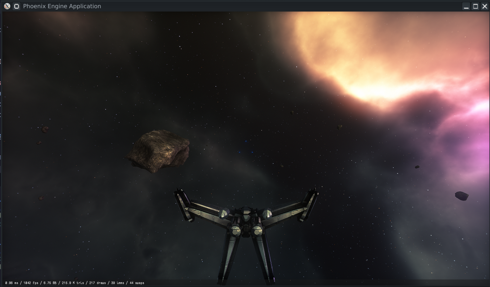

# Limit Theory

> **Disclaimer:** This is a community resurrection/fork of Limit Theory (original work © Josh Parnell). Original code and assets remain under their original license; modifications are provided "as is", without warranty. See `LICENSE` for details.

Limit Theory is a now-cancelled open world space simulation game.

This repository is the game (not engine) code for the second generation of LT's development, when all work was migrated to C and Lua. For the older, C++/LTSL Limit Theory, see https://github.com/JoshParnell/ltheory-old.


# Prerequisites

To build Limit Theory, you'll need a few standard developer tools. All of them are available to download for free.

- Python: https://www.python.org/downloads/
- Git: https://git-scm.com/downloads
- Git LFS: https://git-lfs.github.com/
- Visual Studio Community: https://visualstudio.microsoft.com/vs/ (Windows only)
- CMake: https://cmake.org/download/

**Linux users:** You'll also need these system libraries for the engine to run:
```bash
sudo apt install libglew-dev libsdl3-dev libfreetype6-dev liblz4-dev libluajit-5.1-dev libbullet-dev
```

# Building

With the above prerequisites installed, open a **Git Bash terminal**.

## Checking out the Repository

First, use `cd` to change directories to the place where you want to download LT.
- `cd ~/Desktop/<path where you want to put the LT source>`

Before doing any other `git` commands, make sure LFS is installed:
- `git lfs install`

You should see `Git LFS initialized` or a similar message. **Important**: if you forget to install and initialize Git LFS, most of the resources will probably be broken, and the whole process will likely fail in strange and mysterious ways. This is a common gotcha with projects that use LFS. Make sure you do the above step!

Now, you can download the repository:

- `git clone --recursive https://github.com/darkoned12000/ltheory-test.git ltheory-test`

## Compiling

Once you have the repository, the build process proceeds in two steps (as with other CMake builds): generating the build files, and then building. There is a Python script `configure.py` at the top level of the repository to help you do this easily.

From a terminal in the directory of the checked-out repository, run

- `python configure.py`

This runs CMake to generate the build files. Then, to compile,

- `python configure.py build`

## Running a Lua App

If the compilation is successful, you now have `bin/lt64.exe`, which is the main executable. This program launches a Lua script. The intention was for Limit Theory (and all mods) to be broken into many Lua scripts, which would then implement the gameplay, using script functions exposed by the underlying engine.

To launch a Lua script, you can again use the python helper:
- `python configure.py run`

To run the default script ('LTheory'), or
- `python configure.py run <script_name_without_extension>`

to run a specific script. All top-level scripts are in the `script/App` directory.

# Resurrection Progress & How to Run on Linux

This repository has been resurrected and runs on Linux with a modernized rendering pipeline: **OpenGL 4.6 core** with GLSL 460 shaders, a deferred renderer with GTAO/SSAO, HDR tonemapping, bloom, TAA, point-light and directional (sun) shadow maps, a volumetric nebula, and the full game loop (rendering, physics, AI) running without crashing. The main game app (`LTheory`) boots, generates a world, spawns ships, asteroids, planets, and stations, and runs the economy. Audio is handled by miniaudio (WAV/MP3/OGG), windowing/input by SDL3.

## Prerequisites for Linux

In addition to the standard prerequisites above, you need these system libraries:

- `libglew-dev` (2.3+) — GL Extension Wrangler; loads OpenGL 4.6 entry points.
- `libsdl3-dev` — SDL3; windowing, GL context, input (keyboard/mouse/gamepad).
- `libfreetype6-dev` (2.14+) — FreeType font rasterization.
- `liblz4-dev` (1.10+) — LZ4 compression for serialized asset data.
- `libluajit-5.1-dev` (OpenResty LuaJIT 2.1) — scripting runtime (Lua 5.1 ABI).
- `libbullet-dev` (3.24+) — Bullet physics: rigid bodies, collisions, swept asteroid fields.
- A working OpenGL 4.6 driver (Mesa llvmpipe works for software rendering).

Install them with:
```bash
sudo apt install libglew-dev libsdl3-dev libfreetype6-dev liblz4-dev libluajit-5.1-dev libbullet-dev
```

## Building on Linux

The build system is primarily configured for Windows, but has basic Linux support in `CMakeLists.txt`. Run:
```bash
python configure.py
python configure.py build
```

This will produce the engine library and executable in `bin/`.

## Running on Linux

The engine no longer requires `LD_LIBRARY_PATH`. The simplest way to launch is via the
bundled launcher, which `cd`s to the project root and sets `LD_LIBRARY_PATH` as a safety
net:

```bash
cd <root directory where the ltheory-test code is>
./run.sh LTheory
```

For a one-command setup (install dependencies, configure, build), use:

```bash
./bootstrap.sh
./run.sh LTheory
```

You can also run the binary directly from the project root without any environment
variables — `$ORIGIN`-based rpath resolves the shared libraries automatically:

```bash
cd <project root>
./bin/lt64r LTheory
```

## Example of the Entire Process on Linux

Open a terminal and run:

```bash
cd ~/Documents/Code_Projects/ltheory-test
./run.sh LTheory
```



Replace the path with your actual project location. The `lt64r` executable is the Linux version (the `.exe` files are Windows-only).

## Playing & Interacting

- **Fly:** mouse / WASD-style ship controls (see `script/Game/Controls/ShipBindings.lua`).
- **Fire:** hold **left mouse** (or right gamepad trigger). Turrets auto-aim at your crosshair.
- **Lock target:** press **`T`** to lock the entity nearest your crosshair; **`G`** clears. A colored health bar (`cur / max`) is drawn over the locked target.
- **Destroy things:** shoot or ram asteroids. A destroyed asteroid shatters into 2–4 smaller asteroids (which also take damage and cascade), plus an explosion burst. Dead entities are automatically removed from the world.
- **Debug damage:** set `Config.debug.damageLog = true` in `script/Config.App.lua`, then run `./run.sh LTheory 2>&1 | grep DAMAGE` to watch every hit in the console.
- To see target brackets, set `Config.ui.showTrackers = true` in `script/Config.Local.lua`.

## Learning the Engine / Building Scenes

The gameplay is pure Lua in `script/`. A few starting points:

- **Spawn a field of asteroids** (in `script/App/LTheory.lua` or any app):
  ```lua
  self.system:spawnAsteroidField(2000, 20)   -- count, oreCount
  ```
  Or one asteroid manually:
  ```lua
  local a = Entities.Asteroid(seed, scale)
  a:setPos(Vec3f(x, y, z))
  self.system:addChild(a)
  ```
- **Make something destructible** (pattern in `script/Game/Entities/Asteroid.lua`):
  ```lua
  self:addHealth(maxHp, 0)                    -- 0 = no regen
  self:register(Event.Destroyed, function (self, source)
    -- spawn debris / fragments / explosions here
  end)
  ```
  Damage is applied via `entity:damage(amount, source)`; at 0 health it fires `Event.Destroyed`.
- **Shaders** live in `res/shader/` (vertex + fragment `.glsl`), loaded at runtime via `Cache.Shader(vs, fs)`. The engine prepends `#version 460 core` and runs a custom preprocessor (`#include`, `#autovar`). See `AGENTS.md` for conventions.
- **Documentation for contributors:** see `AGENTS.md` — it tracks build state, LuaJIT/Bullet notes, and gameplay-system internals (asteroids, damage, targeting, ramming, entity GC, economy).

## Recommended Roadmap

- Procedural content: ice/metallic asteroid variants, nebula gas capture, loot on destruction.
- Save/load format: full game-state serialization.
- Streaming + LOD crossfade for smoother asteroid-field streaming at range.
- Graphics-options parity: motion blur, shadow-quality master, PCF radius.
- Documentation: CONTRIBUTING guide, license file.

## What Was Fixed to Get It Running

- **Bullet Physics ABI mismatch**: removed old Bullet 2.87 include path; now uses system Bullet 3 headers/libs.
- **Texture resilience**: missing textures fall back to magenta instead of crashing.
- **Shader pipeline**: GLSL 460 core, deferred G-buffer with explicit `out vec4 fragData0/1/2`, GTAO/SSAO, HDR tonemapping, bloom, TAA, shadow maps.
- **Audio**: migrated from FMOD to miniaudio (WAV/MP3/OGG).
- **Windowing/input**: migrated from SDL2 to SDL3.
- **Asteroids destructible**: health + `Event.Destroyed` shatters into 2-4 smaller asteroids + explosion.
- **Entity GC**: `System:sweepDestroyed` removes dead entities and their rigid bodies.
- **Ramming damage**: symmetric collision damage based on relative impact speed.
- **Targeting/lock**: `T` locks nearest entity, `G` clears; health bar drawn over target.
- **LuaJIT 2.1** (OpenResty) on Linux; build is relocatable via `$ORIGIN` rpath; `run.sh`/`bootstrap.sh` provided.

